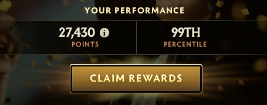

# Dota 2 Fantasy 2026

Congratulation Team Spirit for winning TI15

This project is forked from bydoodle/dota2fantasy (https://github.com/bydoodle/dota2fantasy)

This repository contains the data processing and statistics pipeline behind the original version of the project. The application was built to collect match data, process player performance and generate additional Fantasy League statistics from just The International 2026 matches.

## Result

This year I came close to the top 1,500 and the full rewards. My 99th-percentile finish was an improvement over last year's 95th percentile, even though there were more guides online and more player interest, making this year tougher.

## Fantasy stat priorities

These are my findings for choosing fantasy stats, compared with the Reddit recommendations. Rankings are approximate: `>` means preferred, and `>>` indicates a larger gap. FB means first blood.

| Role | Color | My findings |
| --- | --- | --- |
| Core | Red | Creeps &gt; GPM &gt;&gt; Deaths &gt; Towers / Kills &gt;&gt;&gt; Madstones |
| Core | Green | Teamfight (very stable) &gt;&gt; Stuns (depends on hero picks) &gt; Roshan &gt; FB (risky) &gt; Tormentor / Courier kills |
| Mid | Red | Creeps &gt; GPM &gt; Deaths (stable) &gt; Kills &gt;&gt; Madstones &gt; Towers |
| Mid | Green | Teamfight &gt;&gt; Stuns &gt; FB (risky) &gt; Roshan (long games) &gt; Tormentor &gt;&gt; Courier kills |
| Mid | Blue | Runes &gt;&gt;&gt; Camps / Lotuses (uncertain) &gt; Watchers (stat uncertain) &gt;&gt;&gt; Everything else |
| Support | Green | Teamfight &gt;&gt;&gt; Stuns &gt;&gt; Everything else |
| Support | Blue | Camps &gt; Wards / Smokes &gt; Lotuses / Watchers &gt;&gt; Runes |

For mid red stats, kills may be better in theory, but the observed statistics favored deaths. For support blue stats, camps were great and wards / smokes were good; lotuses and watchers might also be viable.

<details>
<summary>Reddit recommendations</summary>

RoleColorPriorityCoreRedCreeps >> GPM > Deaths (stable) / Towers (risky) > Kills > MadstonesCoreGreenRoshan > Teamfight > Tormentor >>> Stuns >>> Courier kills / FBMidRedCreeps > GPM > Deaths (stable) / Kills (risky) >> Madstones > TowersMidGreenTeamfight > Stuns (stable) / Tormentor (risky) >>> Roshan >>> Courier kills / FBMidBlueRunes >>> Camps / Lotuses >>> Everything elseSupportGreenTeamfight > Tormentor > Courier kills > Stuns >>> FB / RoshanSupportBlueWards / Smokes > Lotuses / Camps >> Watchers >>> Runes

</details>

## ✦ Current version

The original project is from 2025. I disagree with some processing pipeline, so i decide to rewrite that logic and keep only the React + Vite part with few modifications.

The newer version of the project is available here:

[**Dota Fantasy 2026**](https://maruusha.github.io/dota2fantasy/)

This repository will get update every year from now on (hopefully).

## What it does

The project processes competitive Dota 2 match data and calculates a wide range of statistics used by the Fantasy League system.

The resulting data is stored locally in CSV files and used by the web application.

## Data sources

The parser uses data from:

- [OpenDota](https://www.opendota.com/)

## Project structure

```text
.
├── data/
│   ├── 2026/
│   │   ├── group_stage/              # Match JSON and generated group-stage CSVs
│   │   ├── main_event/               # Match JSON and generated main-event CSVs
│   │   ├── heroes.json
│   │   ├── hero_types.json
│   │   ├── leagues.json
│   │   └── players_stat.json
│   └── match_existed_id.txt          # IDs already collected by the crawler
├── dota2parser/                      # React + Vite frontend
├── notebooks/                        # Group-stage and main-event analyses
├── results/2026/                     # Generated result summaries
├── scripts/
│   ├── 1_crawl_matches.py
│   ├── 2_matches_to_csv.py
│   ├── 3_compute_fantasy_score.py
│   ├── 4_compute_series_scores.py
│   ├── 5_compute_series_stat_scores.py
│   ├── 6_build_player_stats.py
│   ├── heroes_parser.py
│   └── get_leagueid_from_gameid.py
└── README.md
```

### Main scripts

The numbered scripts form the data pipeline: collect matches, export match data, calculate fantasy and series scores, then build the player-stat cache used by the frontend.

## TODO (next year)

Filter by team

Suggest by Kams - Average of all stat by 1 position in **Best Stat Scores**

Suggest by Kams - Select players, select X number of best game (by stat of choice), show X heros that player play, border hero icon with the color same as its color (for the prefix, might work with suffix). By me, show how much point gained if select this prefix for these X matches

Auto-loaded your stats with json: You input once, i export you json string, you keep somewhere, when you need to check score again, you paste the json string in (Or CV script to read <span style="color: rgb(8, 8, 9);">stat image - OCR</span>)

## Status

**Finished all data of TI26**

Analyze/Visualize data to notebook - todo

update UI - todo

conclusion of this year - todo
conclusion of this year - todo